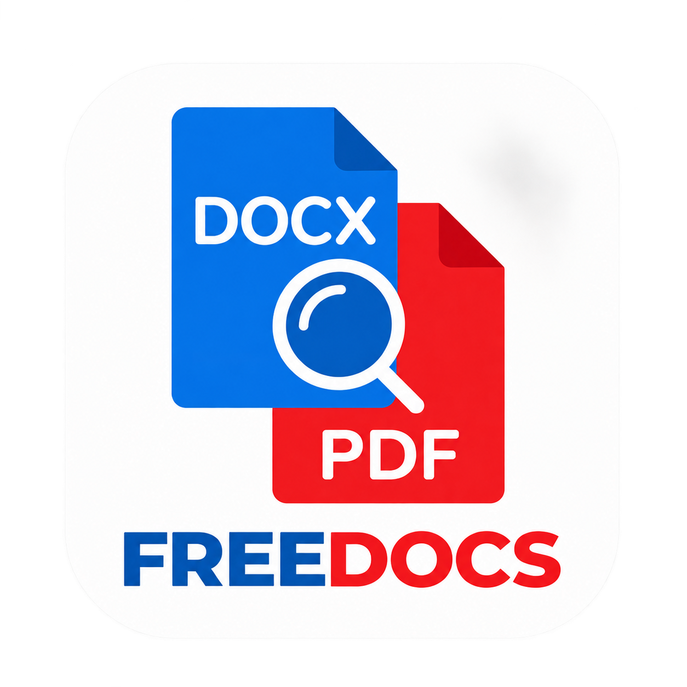

# FreeDocs para Android

<p align="center">
  
</p>

Lector Android ligero para abrir archivos PDF y documentos de Word desde el selector del dispositivo. La app trabaja localmente y permite ampliar el contenido con gestos de zoom.
Ahora
> **Estado:** PDF tiene vista por páginas con zoom. DOC y DOCX disponen de vista **Hoja (Diseño)** con paginación, márgenes, tablas, imágenes y zoom fiel vía el motor offline de LibreOfficeKit, además de la vista conmutable **Móvil (Texto)** con texto reajustado al ancho. Consulta [WORD_POR_HOJAS.md](WORD_POR_HOJAS.md) y [LEGAL_NOTICE.md](LEGAL_NOTICE.md).

## Funciones

- Abrir PDF, DOCX y DOC mediante el selector de archivos de Android.
- Leer PDF por páginas, navegar entre ellas y ampliar hasta 6× con pellizco o doble toque.
- Vista Word **Hoja**: lectura fiel por páginas conservando el formato original, tamaño de papel, márgenes, tablas e imágenes mediante conversión local y visor por bloques con zoom.
- Vista Word **Móvil**: lectura de texto con ajuste automático al ancho de la pantalla y zoom con pellizco.
- Selector de modo conmutable **"Hoja | Móvil"** para Word, conservando la posición de lectura y nivel de zoom en cada vista.
- Mantener el archivo original intacto. La app procesa el documento en su almacenamiento privado temporal y elimina los archivos temporales al cerrar el documento.
- Funcionamiento 100% offline: no requiere conexión a Internet ni permisos de red ni acceso general al almacenamiento.

## Requisitos

- Android 6.0 o posterior (API 23+).
- Android Studio con Android SDK 35 y JDK 17 para compilar.

## Abrir y compilar

1. Clona este repositorio y abre su carpeta en Android Studio.
2. Espera a que Gradle sincronice las dependencias.
3. Conecta un teléfono con depuración USB o inicia un emulador.
4. Ejecuta la configuración **app** desde Android Studio.

Para generar el APK de depuración desde PowerShell:

```powershell
.\gradlew.bat assembleDebug
```

El APK queda en `app/build/outputs/apk/debug/app-debug.apk`. Para una compilación de producción:

```powershell
.\gradlew.bat assembleRelease
```

El APK release requiere firma antes de distribuirse. No publiques la clave de firma ni sus contraseñas en el repositorio.

## Detalles técnicos

- Kotlin, Android Gradle Plugin 8.7.3 y Gradle Wrapper 8.14.3.
- PDF: `PdfRenderer` de Android con renderizado por bloques de 512 px, caché limitada y zoom mediante gestos.
- DOCX: parser XML de Android con límites de tamaño y descompresión.
- DOC: Apache POI Scratchpad 5.5.1.
- La lectura y el renderizado se ejecutan fuera del hilo de interfaz.
- Los límites actuales son 100 MiB para PDF, 12 MiB para Word, 8 MiB de XML descomprimido y un millón de caracteres.
- Se adapta la clase `CleanerUtil` de POI para mantener compatibilidad con API 23. La razón y el alcance están documentados en `app/build.gradle.kts`.

## Licencias

La app incluye Apache POI y sus dependencias, que llevan sus propios avisos de licencia en los artefactos Android. Consulta las licencias y avisos empaquetados en el APK antes de redistribuirlo, y conserva los avisos requeridos. La licencia de la imagen de marca depende de los derechos del archivo original proporcionado para el proyecto.

## Documentación

- [Plan para mostrar Word por hojas](WORD_POR_HOJAS.md)
- [Estado y comprobaciones de validación](VALIDACION.md)
- [Preparación de los iconos](artwork/README.md)

